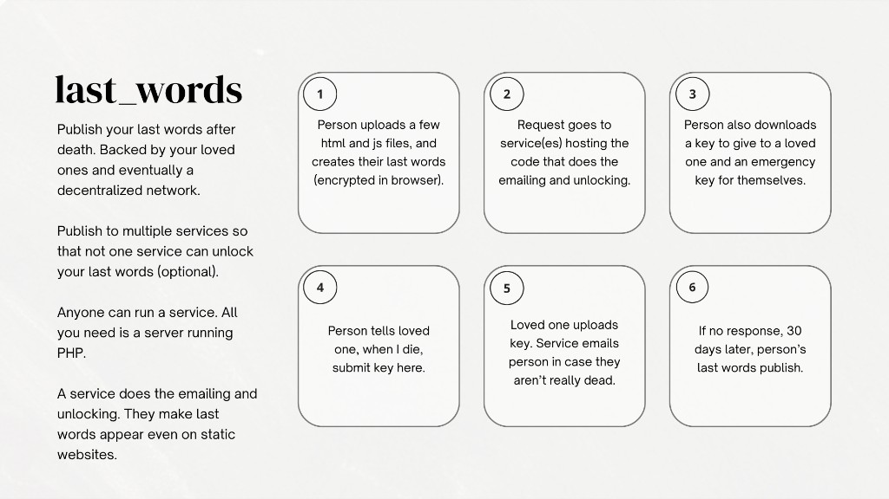

# Last Words

Last Words lets a person store a private message on their own website and name someone they trust to ask for it to be published after they have died. The message stays encrypted. Publishing waits 30 days so the owner can cancel by email. A separate recovery key can re-lock the message if it goes out by mistake.

The same recovery file can replace the sealed text years later. The message key does not change, so the trusted person file still works. Saving new words requires that file. The page alone is not enough. The owner uploads the new `config.js` the page downloads.

The software does not know whether someone has died. It follows the keys.

Anyone can run a service. Services are peers. There is no account to apply for, and no central service that every installation must trust.

## Which file to use

`./release.sh` writes three zip files into `dist/`. A published release is those same files.

- **`last-words-1.0.0-service.zip`** is for someone starting a service. Upload it into the site folder the host already uses, then open `install/` in a browser.
- **`last-words-1.0.0-page.zip`** is for someone leaving a message on their own website. Upload it into a folder on that site, then open `setup.html`.
- **`last-words-1.0.0.zip`** is the whole project, for reading the code, the docs, and the tests.

The version number in the file name matches `src/Version.php`.

## Start here

- [Install a service](docs/installation.md)
- [Create a Last Words page](docs/using-last-words.md)
- [Run your own service](docs/becoming-a-service.md)
- [Protocol](docs/protocol.md)
- [Security and limits](docs/security.md)
- [Backup and recovery](docs/recovery.md)
- [Report a vulnerability](SECURITY.md)

A running service also has these guides on its own site: `guide.php` and `become.php`.

## What a locked message is

The owner's browser encrypts the message with a random key, then splits that key. Each chosen service stores the ciphertext and only its own share. With one service, that share is the whole key. With two, both shares are required. With three or more, the default threshold is two, so one service cannot read the message. After a valid waiting period, services release their shares and the owner's page reconstructs the key in the visitor's browser.

Re-locking tells participating services to stop handing the message out. It cannot erase a copy someone already saved.

## Requirements

PHP 8.2 or newer, with PDO SQLite, Sodium, OpenSSL, and JSON. HTTPS in production. A private directory the installer can prove is not downloadable. SMTP for mail. No Node.js, database server, Docker, or Composer is required on the host. PHPMailer 6.9.3 is included under `lib/phpmailer/`.

## Tests

```
php tests/run.php
```

The suite uses a stand-in clock, so the 30 day wait is tested without waiting 30 days. It also checks the browser code against the PHP service.

## How it will work:


